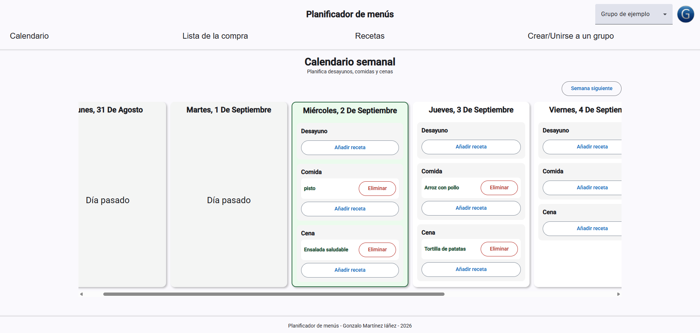
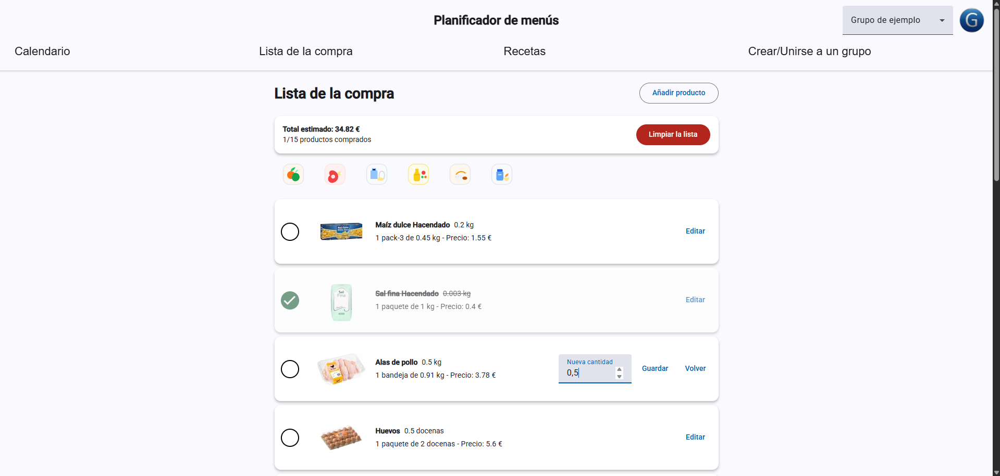
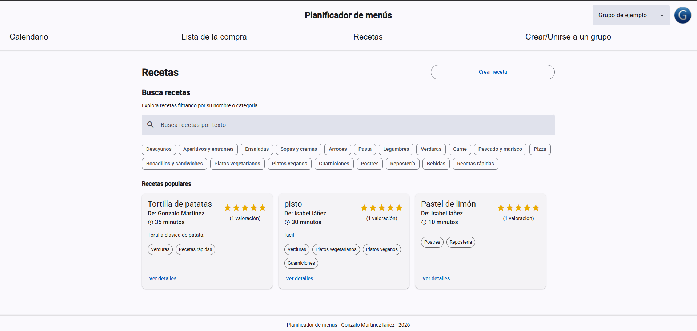
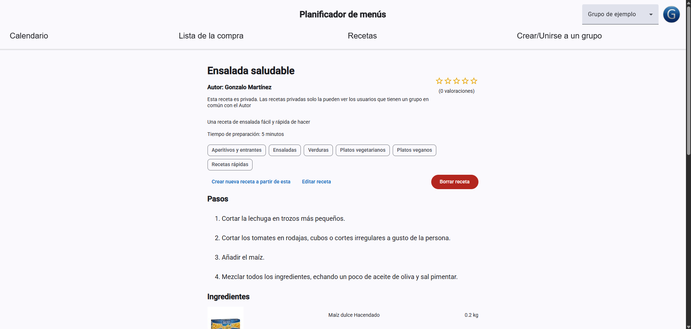
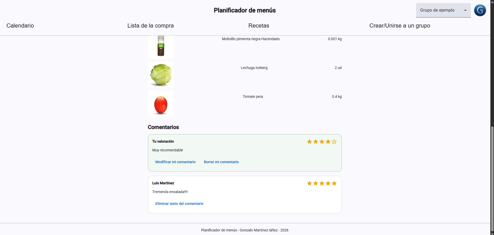
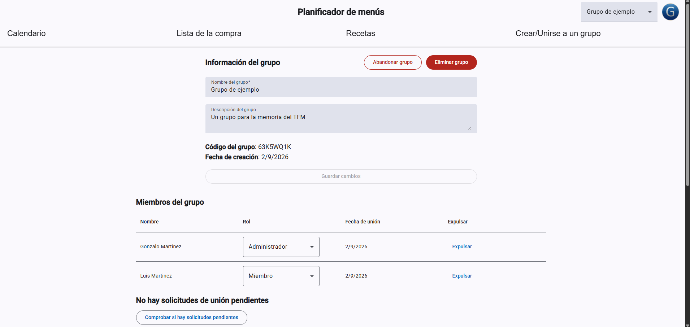
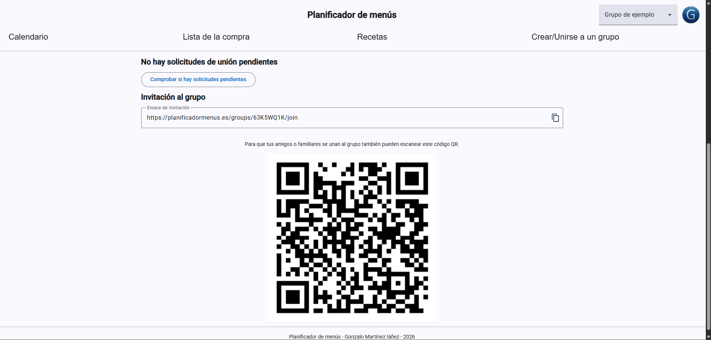

# Planificador de menús

## Gonzalo Martínez Iáñez

Aplicación web para planificar menús compartidos, guardar recetas y generar una lista de la compra para cada grupo.

Proyecto desarrollado como Trabajo Fin de Máster del Máster en Desarrollo de Aplicaciones Web de la Universidad Europea.

La aplicación está desplegada en https://planificadormenus.es/login.

## Funcionalidades

- Inicio de sesión con Google y autenticación mediante JWT.
- Creación, administración e invitación a grupos mediante enlace y código QR.
- Calendario semanal con desayuno, comida y cena.
- Lista de la compra generada a partir de las recetas del menú y editable manualmente.
- Buscador de recetas por nombre y categorías.
- Recetas públicas y privadas, con ingredientes, pasos, valoraciones y comentarios.

## Capturas

### Calendario semanal



### Lista de la compra



### Buscador de recetas



### Recetas




### Administración de grupos




## Tecnologías

- Frontend: Angular 21 y Angular Material.
- Backend: Django 6 y Django REST Framework.
- Autenticación: Google Identity Services y Simple JWT.
- Base de datos: SQLite en desarrollo y MySQL 8.4 en producción.
- Despliegue: Docker Compose, Nginx, Uvicorn y Let's Encrypt.
- CI/CD: GitHub Actions y GitHub Container Registry.

## Estructura

```text
PlanificadorMenus/
|- pmangular/     # Aplicación Angular
|- pmdjango/      # API Django
|- deploy/        # Inicialización de Let's Encrypt
|- IMG/           # Capturas de la aplicación
|- docker-compose.yml
|- .env.example
```

## Desarrollo local

Consulta las instrucciones concretas de cada aplicación:

- [Frontend Angular](pmangular/README.md)
- [Backend Django](pmdjango/README.md)

Calendario, lista de la compra y gestión de grupos reciben actualizaciones por
WebSockets. Las acciones siguen usando la API REST. Docker Compose añade Redis
como servicio interno (límite de 256 MiB), compartido por los tres procesos del
backend; Nginx reenvía `/ws/`. Al actualizar el servidor se necesita también el
Compose y la configuración Nginx de esta versión. Consulta los README de cada
aplicación para desarrollo, autenticación y recuperación de la conexión.

## Prueba completa con Docker en local

Esta opción compila el código de tu carpeta y ejecuta Nginx, MySQL 8.4, Redis y
los tres procesos de Uvicorn. Usa HTTP en `http://localhost:4200`, sin Certbot ni
certificados. Tiene nombre de proyecto, red y volumen de MySQL propios; no utiliza
el Compose ni el archivo `.env` del VPS. La base local empieza vacía y conserva
los datos entre arranques. No importa automáticamente la base de SQLite.

Abre Docker Desktop con el motor de contenedores Linux activo. Detén `ng serve`
si está usando el puerto 4200. Desde la raíz del repositorio, crea una vez el
archivo local:

```powershell
Copy-Item .env.docker.local.example .env.docker.local
```

Edita `.env.docker.local` y cambia `AUTHORIZED_EMAIL` por los correos de tus cuentas
de prueba, separados por comas. El `GOOGLE_CLIENT_ID` debe coincidir con el cliente
público de `pmangular/src/environments/environment.development.ts`. Ese cliente
debe tener autorizados `http://localhost` y `http://localhost:4200` como orígenes
JavaScript en Google Cloud. Si usas `http://127.0.0.1:4200`, autoriza también ese
origen en el mismo cliente: Google distingue ambos nombres, aunque lleven al mismo
equipo. El mensaje `The given origin is not allowed for the given client ID` se
corrige en la configuración del cliente OAuth, no añadiendo permisos CORS en Django.
Las contraseñas de ejemplo y la clave de Django son solo para esta instalación local.
El archivo local está excluido de Git; no sobrescribas el existente al actualizar.

```powershell
docker compose --env-file .env.docker.local -f docker-compose.local.yml up --build -d --wait
```

El primer arranque descarga las imágenes, compila ambas aplicaciones, inicializa
MySQL y aplica las migraciones a esa base local. Espera a que MySQL, Redis y la API
estén disponibles antes de abrir Nginx. Después abre `http://localhost:4200`.
El frontend usa `/api` y `/ws` del Nginx local; no llama a la API de producción.
Las URL de API, WebSockets e invitaciones usan el origen de la ventana actual,
evitando cruzar `localhost` con `127.0.0.1`. El backend local admite ambos orígenes.
Solo el puerto de la web se publica, vinculado a `127.0.0.1`.

Comprobaciones útiles:

```powershell
docker compose --env-file .env.docker.local -f docker-compose.local.yml ps
docker compose --env-file .env.docker.local -f docker-compose.local.yml logs -f backend nginx redis
docker compose --env-file .env.docker.local -f docker-compose.local.yml exec nginx nginx -t
docker compose --env-file .env.docker.local -f docker-compose.local.yml exec redis redis-cli ping
```

`redis-cli ping` debe responder `PONG`. Prueba calendario, lista, aceptación y
permisos con dos sesiones; en las herramientas del navegador `/ws/events/` debe
tener estado 101. Puedes comprobar la recuperación deteniendo y arrancando Redis:

```powershell
docker compose --env-file .env.docker.local -f docker-compose.local.yml stop redis
docker compose --env-file .env.docker.local -f docker-compose.local.yml start redis
```

Para detener la instalación, conservando los datos:

```powershell
docker compose --env-file .env.docker.local -f docker-compose.local.yml down
```

Después de cambiar código vuelve a ejecutar `up --build -d --wait`; no hay recarga
automática en este modo. Docker reutiliza las capas que no han cambiado. MySQL
aplica las credenciales de inicialización al crear el volumen por primera vez;
editar después las contraseñas del archivo no cambia las de la base existente.
Esta prueba cubre la distribución entre procesos y el proxy de WebSockets; TLS,
certificados y red del VPS se comprueban en el entorno de producción.

## Testing

```bash
cd pmangular
npm test -- --watch=false

cd ..\pmdjango
python manage.py test
```

## Despliegue

El despliegue usa las imágenes publicadas en GitHub Container Registry al crear una etiqueta que comienza por `v`.

```bash
git tag v1.0.0
git push origin v1.0.0
```

En el servidor, crea un archivo `.env` a partir de `.env.example`, indica las imágenes de la nueva etiqueta y ejecuta:

```sh
sudo docker compose pull
sudo docker compose up -d
```

En la primera ejecución, antes de levantar el stack HTTPS, ejecuta:

```sh
sudo sh deploy/init-letsencrypt.sh
```
